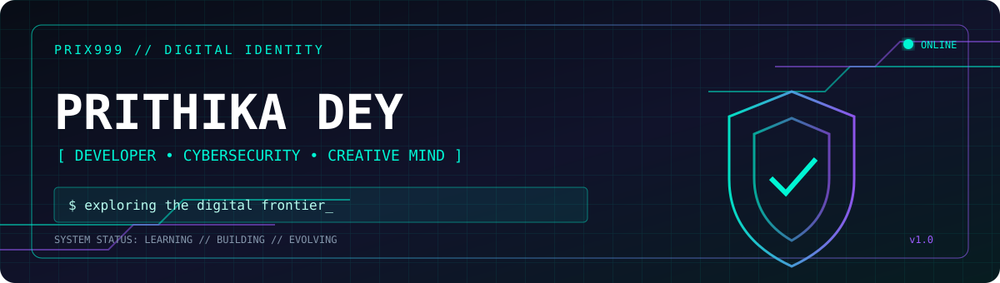

<!-- HEADER -->
<div align="center">




<br/>

[](https://github.com/prix999)
[](https://www.linkedin.com/in/prithika-dey-436738304/)

</div>

---


<h2 align="center">⚡ IDENTITY // USER PROFILE</h2>

<div align="center">

<table>
<tr>
<td align="center">
<h3>👾 PLAYER PROFILE</h3>
<strong>PRITHIKA DEY</strong><br/>
BCA Student | Developer<br/>
Cybersecurity Enthusiast
</td>
<td align="center">
<h3>🛡️ SYSTEM STATUS</h3>
<strong>STATUS: LEARNING</strong><br/>
CLASS: DEVELOPER<br/>
MODE: BUILDING
</td>
</tr>
</table>

</div>

### 🖥️ TERMINAL ACCESS

```bash
┌──(prix999㉿kali)-[~]
└─$ whoami

Prithika Dey
BCA Student | Aspiring Developer

┌──(prix999㉿kali)-[~]
└─$ cat mission.txt

> Explore the digital frontier
> Learn cybersecurity and ethical hacking
> Build meaningful technology
> Turn creative ideas into reality

┌──(prix999㉿kali)-[~]
└─$ echo "NEVER STOP EXPLORING"

NEVER STOP EXPLORING
```

### 🎯 CURRENT MISSIONS

| Mission | Status |
|---|---|
| Web Development | `IN PROGRESS` |
| Cybersecurity | `EXPLORING` |
| Ethical Hacking | `LEARNING` |
| Technology Research | `ACTIVE` |
| Project Development | `BUILDING` |

### 🧩 PLAYER ATTRIBUTES

- 💻 Development & Problem Solving
- 🔐 Cybersecurity Exploration
- 🚀 Hackathons & Innovation
- 🎨 Creative Thinking
- 🎤 Communication & Leadership


<h2 align="center">⚔️ LOADOUT // TECH ARSENAL</h2>

<div align="center">

### 💻 DEVELOPMENT SKILLS


### 🌐 BACKEND & DATABASE


### 🔐 CYBERSECURITY LAB


### ⚙️ DEVELOPMENT ENVIRONMENT


</div>

---

### 🎮 CURRENT PLAYER STATS

| ATTRIBUTE | SPECIALIZATION |
|:---|:---|
| 💻 Development | Web & Backend |
| 🔐 Security | Ethical Hacking Labs |
| 🌐 Networking | Network Fundamentals |
| ⚙️ Hardware | ESP32 & IoT |
| 🚀 Innovation | Hackathons & Projects |

<p align="center">
  <i>⚡ SKILLS UNLOCKED THROUGH LEARNING, BUILDING & EXPERIMENTATION ⚡</i>
</p>


<h2 align="center">🎮 MISSION CONTROL // PROJECT ARSENAL</h2>

<p align="center">
  <code>SELECT YOUR MISSION_</code>
</p>

<table>
<tr>
<td width="50%" valign="top">

<h3>🌍 MISSION 01</h3>

<h2>
  <a href="https://github.com/prix999/TravelMateN">
    🌍 TravelMateNE ↗
  </a>
</h2>

<code>HACKATHON PROJECT</code>

A travel-planning platform created during a hackathon, focused on making travel planning easier and more accessible.

**MISSION OBJECTIVE**
- Simplify travel planning
- Explore intelligent recommendations
- Build a useful travel experience

<p><strong>STATUS:</strong> COMPLETED PROTOTYPE</p>

</td>
<td width="50%" valign="top">

<h3>🌡️ MISSION 02</h3>

<h2>Smart IoT Monitor</h2>

<code>HARDWARE / IOT</code>

An ESP32-based temperature and humidity monitoring system with a monitoring dashboard.

**MISSION OBJECTIVE**
- Monitor environmental conditions
- Work with ESP32 hardware
- Display sensor information

<p><strong>STATUS:</strong> PROJECT BUILT</p>

</td>
</tr>
<tr>
<td colspan="2" valign="top">

<h3>🔐 MISSION 03 // CYBERSECURITY</h3>

<h2>Secure Community Cyber Help Portal</h2>

<code>WEB DEVELOPMENT / CYBERSECURITY</code>

A community-focused cyber help portal developed as a BCA minor project.

**TECH STACK**


**MISSION OBJECTIVE**
- Build a community cyber-help platform
- Develop backend functionality
- Explore secure web development

<p><strong>STATUS:</strong> DEVELOPMENT PROJECT</p>

</td>
</tr>
</table>

<p align="center">
  <code>MORE MISSIONS LOADING...</code>
  <br/>
  
</p>


<h2 align="center">📡 PLAYER DASHBOARD // LIVE TELEMETRY</h2>

<p align="center">
  <code>ACCESSING GITHUB DATABASE...</code>
</p>

<div align="center">


</div>

<h3 align="center">⚡ CONTRIBUTION ACTIVITY</h3>

<div align="center">


</div>

<p align="center">
  
</p>

<p align="center">
  <code>TELEMETRY STATUS: EXTERNAL DATA SERVICES</code>
</p>


<h2 align="center">🏆 ACHIEVEMENT UNLOCKED // XP LOG</h2>

<div align="center">

| LEVEL | ACHIEVEMENT | STATUS |
|:---:|---|:---:|
| 01 | 🚀 Hackathon Participant | UNLOCKED |
| 02 | 🌍 TravelMateNE Project | UNLOCKED |
| 03 | ⚡ ESP32 IoT Project | UNLOCKED |
| 04 | 🔐 Cybersecurity Lab Practice | IN PROGRESS |
| 05 | 🎤 MUN & Public Speaking | UNLOCKED |
| 06 | 💃 Classical Dance & Music | UNLOCKED |

</div>

<p align="center">
  
  
</p>

<p align="center">
  <i>Every project is a new mission. Every skill is another level.</i>
</p>

---

  


<h2 align="center">📡 COMMUNICATION HUB // ESTABLISH CONNECTION</h2>

<p align="center">
  <code>INCOMING CONNECTIONS ACCEPTED...</code>
</p>

<div align="center">

<a href="https://github.com/prix999">
  
</a>

<a href="https://www.linkedin.com/in/prithika-dey-436738304/">
  
</a>

<a href="https://www.instagram.com/prithikadey_/">
  
</a>

<a href="mailto:prithikadey9@gmail.com">
  
</a>

</div>

---

<div align="center">

### 🖥️ END OF TRANSMISSION

```text
[ SYSTEM MESSAGE ]

Thanks for visiting my digital space.

EXPLORE  //  CONNECT  //  COLLABORATE

> Keep learning.
> Keep building.
> Stay curious.
```


<code>PRIX999 © 2026 | BUILT WITH CURIOSITY & CODE</code>

</div>


